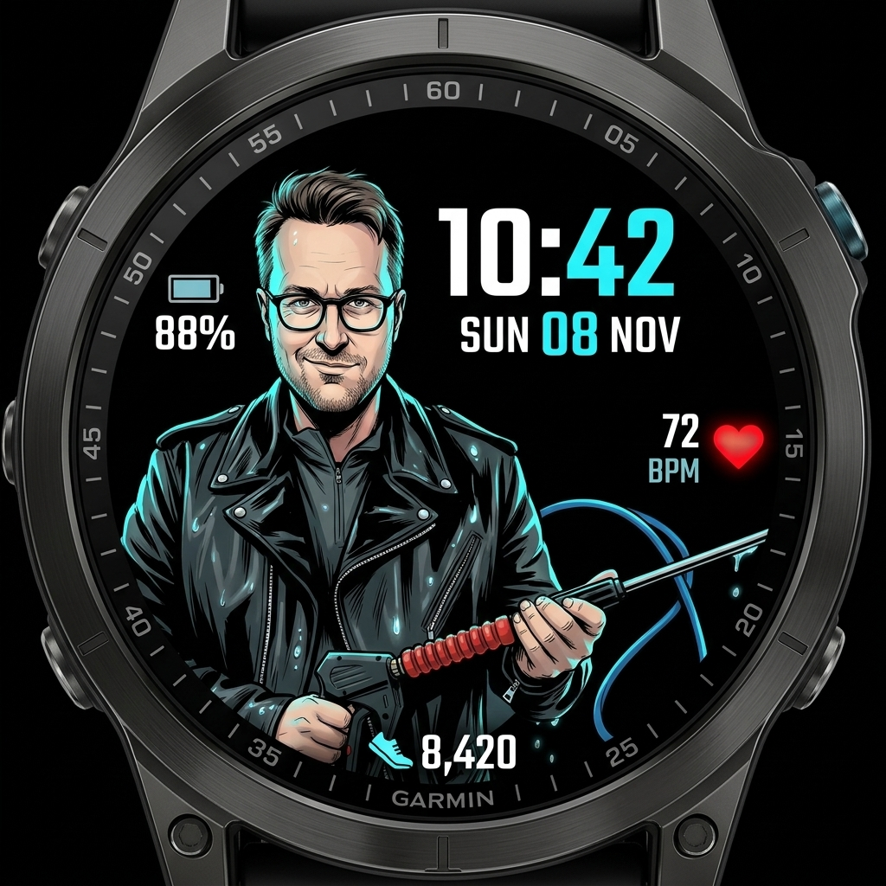
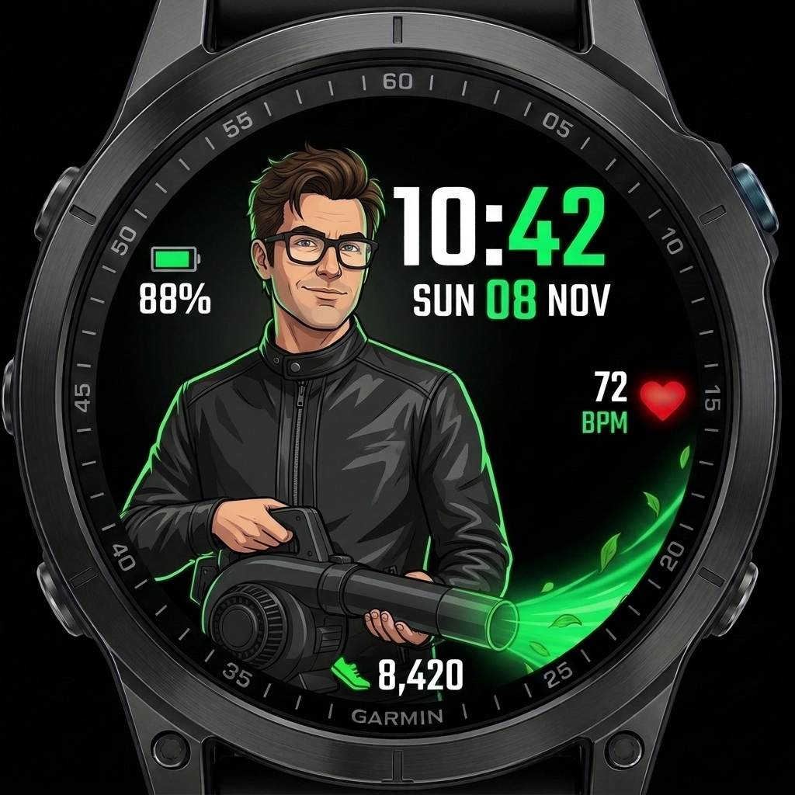
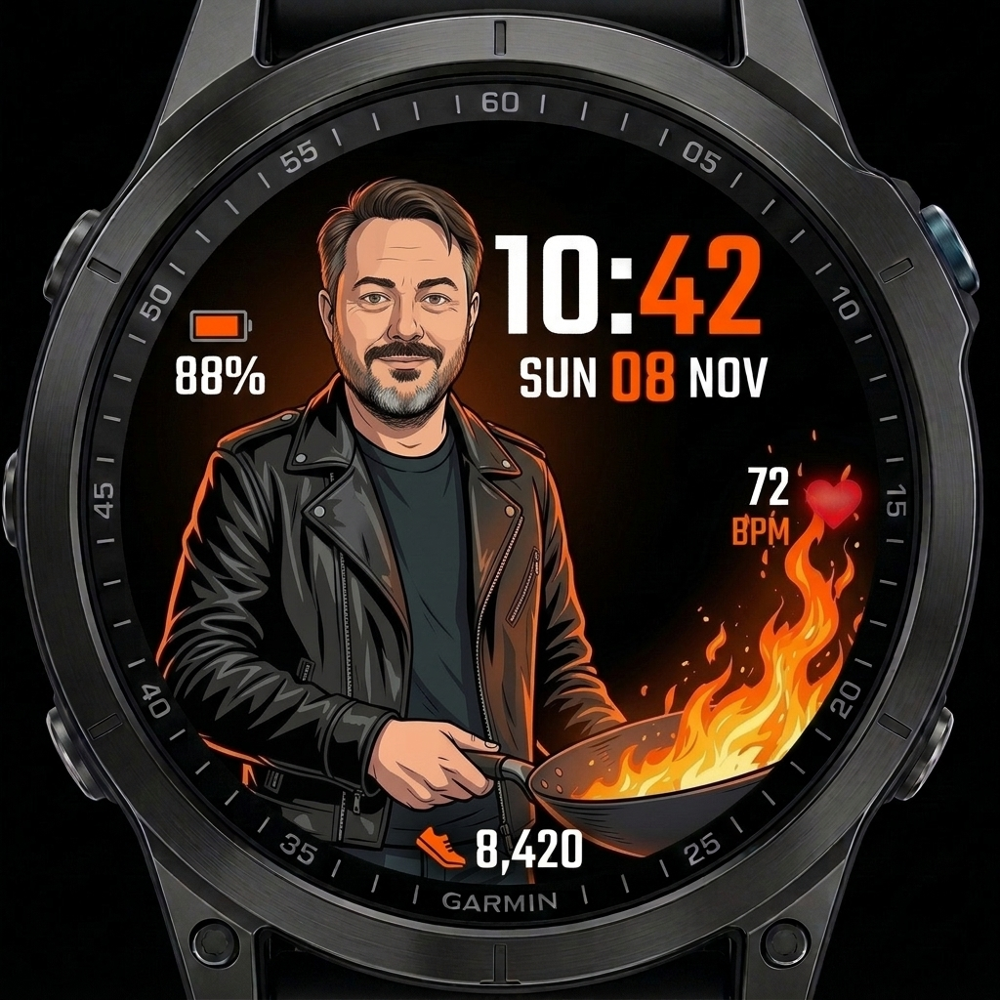
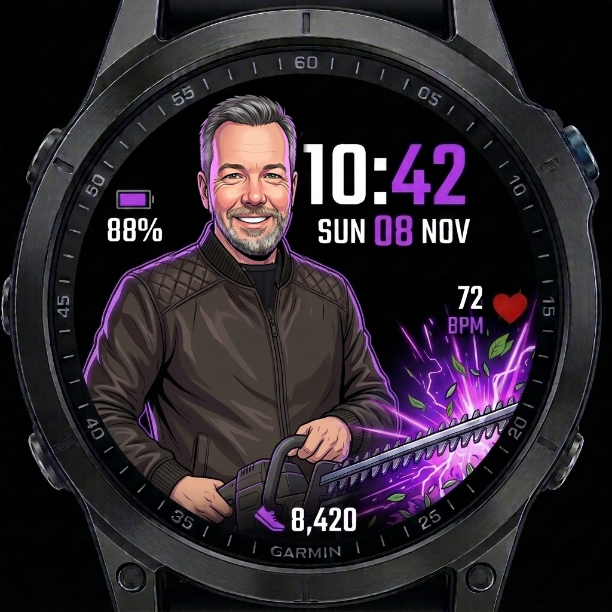
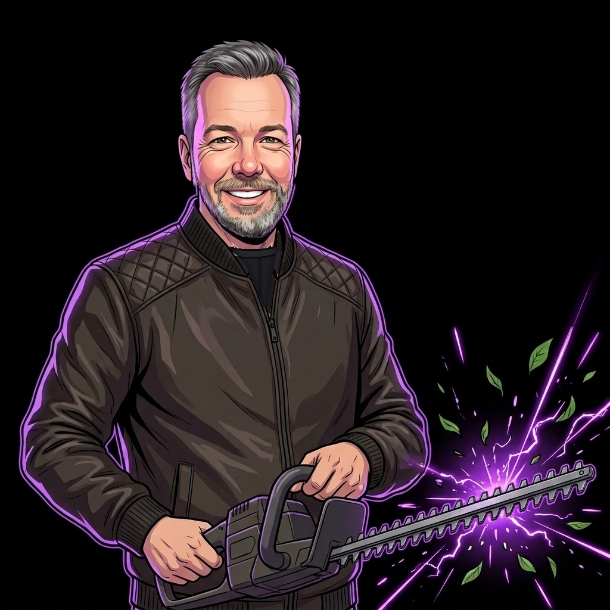

# PowerWash — Garmin Connect IQ Watch Face

<p align="center">
  
</p>

<p align="center">
  
  
  
  
</p>

<p align="center">
  
  
  
  
</p>

A custom Garmin Connect IQ watch face (`type="watchface"`) bundling four stylized action-poster character portraits and matching tactical sports HUD themes in a single `.prg` / `.iq` distribution:
- **Power Washer (`0`)**: Pressure washer action portrait with an **Electric Cyan (`#00AAFF`)** tactical HUD.
- **Leaf Blower (`1`)**: High-velocity leaf blower action portrait with an **Electric Green (`#00FF55`)** tactical HUD.
- **Wok Master (`2`)**: Flaming carbon-steel wok ("wok hei") action portrait with a **Blaze Orange (`#FF5500`)** tactical HUD.
- **Hedge Trimmer (`3`)**: High-voltage power hedge trimmer action portrait with an **Electric Purple (`#AA55FF`)** tactical HUD.
- **Auto-Rotate (`4`)**: Automatically cycles across all four characters every hour (`hour % 4`).

> **Device Compatibility Note:** Built and optimized primarily for the **Garmin fēnix 6S** (`fenix6s` / `fenix6spro`, `240x240` MIP display) and includes resolution-specific background assets (`240x240`, `260x260`, `280x280`, `360x360`, `390x390`, `416x416`, `454x454`) for fēnix 6/7 series, Epix 2, Forerunner 255/265/955/965, and Enduro.

---

## HUD Layout & Features

1. **Four Stylized Action-Poster Portraits (`BackgroundBitmap`, `LeafBlowerBitmap`, `WokBitmap`, `HedgeTrimmerBitmap`)**:
   - Pre-scaled per device resolution (`round-240x240` through `round-454x454`) with Floyd-Steinberg dithering for crisp rendering on 64-color MIP and AMOLED screens.
   - Dynamically loads only the active character bitmap into memory to stay well within Garmin watch face RAM limits.
2. **On-Watch & Mobile App Theme Switching**:
   - **On-Watch Customize Menu (`getSettingsView`)**: Switch between *Power Washer (Cyan)*, *Leaf Blower (Green)*, *Wok Master (Orange)*, *Hedge Trimmer (Purple)*, and *Auto-Rotate (Hourly)* directly from the watch face **Customize** menu on the watch.
   - **Garmin Connect IQ App Settings**: Configure the `CharacterTheme` property from the Garmin Connect IQ mobile app or Garmin Express.
3. **Split-Color Digital Clock & Date (Upper-Right)**:
   - Respects 12-hour and 24-hour device settings (`HH:` in crisp white, `MM` in the active theme's accent color: `#00AAFF` cyan, `#00FF55` electric green, `#FF5500` blaze orange, or `#AA55FF` electric purple).
   - Displays `DOW DD MON` (e.g., `SUN 08 NOV`) directly underneath with theme-colored day highlight.
4. **Live Health & System Metrics**:
   - **Battery (Upper-Left)**: Vector battery gauge with dynamic color thresholds (theme accent color when normal, `#FFAA00` < 30%, `#FF0000` < 15%) and numeric percentage.
   - **Heart Rate (Middle-Right)**: Live wrist heart rate from `Activity.getActivityInfo().currentHeartRate` (with fallback to `ActivityMonitor.getHeartRateHistory`) and vector crimson heart icon.
   - **Steps Badge (Bottom-Center)**: High-contrast tactical pill badge displaying formatted daily steps (`ActivityMonitor.getInfo().steps`).
5. **Low-Power Sleep Mode Aware**:
   - Simplifies the perimeter tick ring during low-power sleep (`onEnterSleep`) to conserve battery.

---

## Option A: Sideload Native Connect IQ Watch Face (`.prg`)

1. Connect your Garmin watch to your computer via USB.
2. Open the watch drive and navigate to `GARMIN/APPS/`.
3. Copy `bin/PowerWash.prg` into `GARMIN/APPS/`.
4. Safely eject the watch and select **PowerWash** from your watch face menu (use **Customize** on the watch or the Connect IQ app to toggle between **Power Washer**, **Leaf Blower**, **Wok Master**, **Hedge Trimmer**, or **Auto-Rotate**).

---

## Option B: Use with Garmin Connect IQ "Face It"

If you prefer to customize data fields directly in the mobile app:

1. Save `assets/store/face_it_background.jpg` (Power Washer), `assets/store/face_it_leafblower_background.jpg` (Leaf Blower), `assets/store/face_it_wok_background.jpg` (Wok Master), or `assets/store/face_it_hedgetrimmer_background.jpg` (Hedge Trimmer) to your phone.
2. Open the **Garmin Connect IQ** app and tap **Face It**.
3. Tap **`+`**, choose **Photos**, and select your preferred background image.
4. Position the digital clock and data complications in the open upper-right dark space and tap **Install**.

---

## Building & Running Tests

1. Compile release binary for `fenix6s`:
   ```bash
   monkeyc -f monkey.jungle -d fenix6s -o bin/PowerWash.prg -y developer_key.der -r -w
   ```
2. Package multi-device Connect IQ Store archive (`.iq`):
   ```bash
   monkeyc -e -f monkey.jungle -o bin/PowerWash.iq -y developer_key.der -r -w
   ```
3. Compile and run unit tests:
   ```bash
   monkeyc -f monkey.jungle -d fenix6s -o bin/PowerWashTest.prg -y developer_key.der -t
   monkeydo bin/PowerWashTest.prg fenix6s /t
   ```

---

## License

Licensed under the [MIT License](LICENSE).
